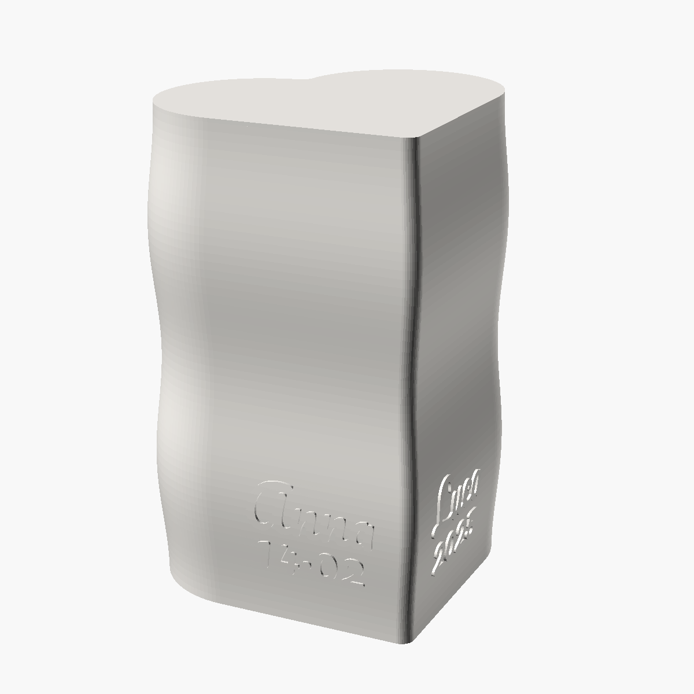
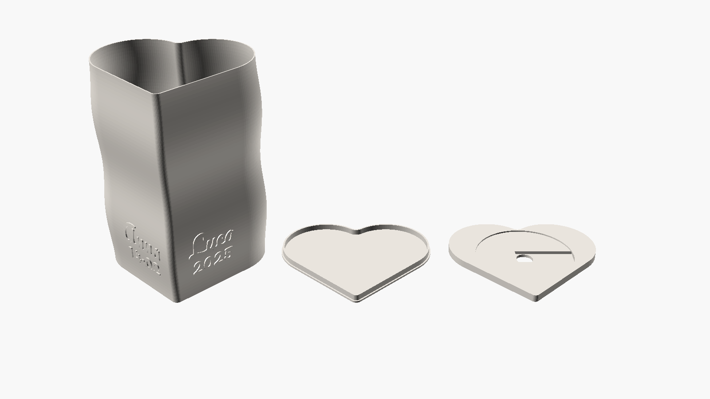
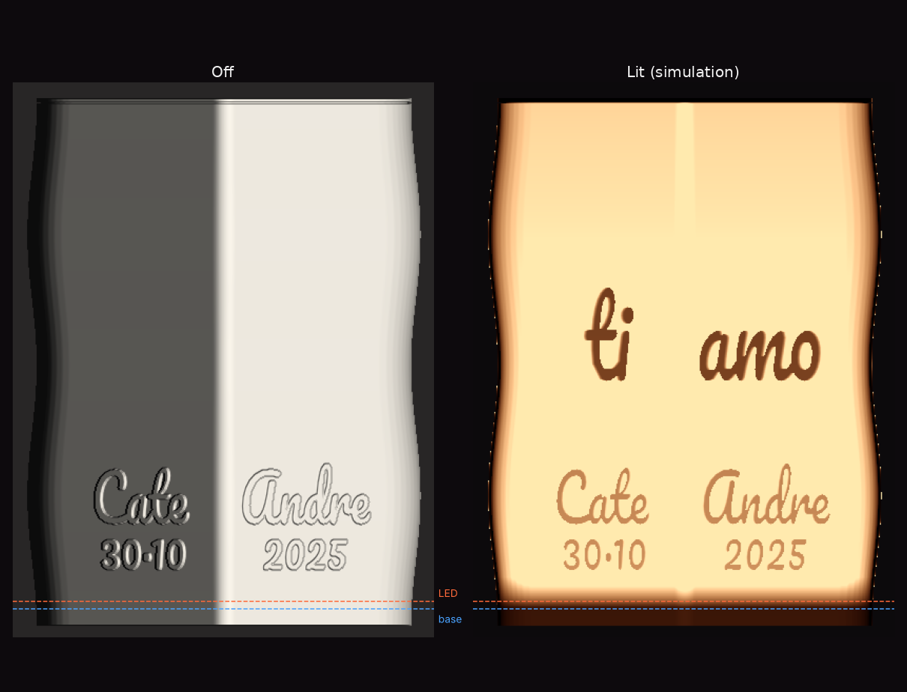
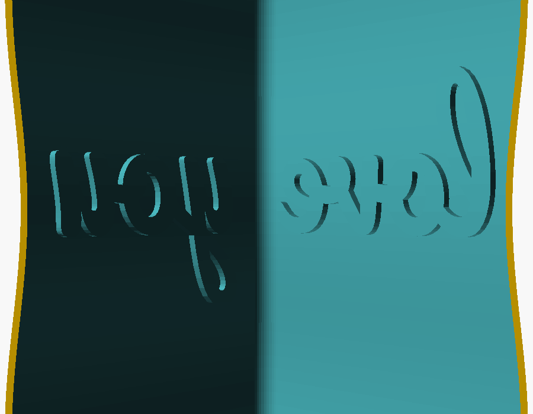

# 3D models

A heart-shaped shade with a gentle wave, a cap, and a base that holds the 16-LED ring. Print one set per lamp. Print settings: [PRINTING.md](PRINTING.md).

<p align="center">
  
  
</p>

## STL files

Click a file to open it in GitHub's interactive 3D viewer.

| File | Part | Size (mm) | Per lamp |
| --- | --- | --- | --- |
| [tube_v4.stl](tube_v4.stl) | Shade: heart-shaped tube with a wave, open at both ends, 0.8 mm wall. Our names and date outside, "ti amo" inside. | 112 × 101 × 149 | 1 |
| [cap_v4.stl](cap_v4.stl) | Cap: 1.2 mm plate with a 4 mm rim that fits inside the shade (0.25 mm gap). | 107 × 96 × 5.2 | 1 |
| [base_v4_1.stl](base_v4_1.stl) | Base, 5 mm thick: seat for the ring (Ø 69.2 mm, 1 mm deep), 12 mm wire hole, channel for the ring pads (14 mm wide, 2.4 mm deep). | 104 × 94 × 5 | 1 |

The published shade carries our own texts. To make one with yours, generate it from the parametric source below.

The lettering is in Pacifico, raised by 0.8 mm outside. Left and right are meant looking at the tip of the heart. The hidden message inside sticks out 1.5 mm towards the inside: you only see it in backlight, when the lamp is on.



Base v4.1 replaces base v4: with the solder joints under the pads, the ring stayed lifted on one side, so v4.1 adds a channel from the center hole to the wall of the seat. The outer heart outline is the same as v4, so the shade fits the same way.


## Parametric source

[source/heart_lamp_parametric.scad](source/heart_lamp_parametric.scad) is the OpenSCAD model the STL files come from. Its default texts are examples ("Anna", "Luca", "14·02", "2025", and "love you" inside).

<p align="center">
  
</p>

### Parameters

**Part**

| Parameter | Default | Meaning |
| --- | --- | --- |
| `part` | `"tube"` | `tube`, `cap`, `base`, or `all` (preview only: the three parts do not fit one plate) |

**Outside text**

| Parameter | Default | Meaning |
| --- | --- | --- |
| `left_name`, `right_name` | `"Anna"`, `"Luca"` | Names on the two flat sides |
| `left_date`, `right_date` | `"14·02"`, `"2025"` | Small texts under the names (for example day and month, and year) |
| `font` | `"Pacifico"` | Font of all texts. Script fonts with joined letters look best (Pacifico, Lobster, Dancing Script) |
| `name_size` | 14 mm (8–24) | Height of the names. About 6–7 letters fit at 14 mm: for longer names lower it (text past the tip is cut) |
| `date_size` | 11.5 mm (6–20) | Height of the small texts |
| `name_z`, `date_z` | 29 mm, 16 mm | Height of the baselines from the bottom of the shade. Keep the text above the LEDs (the ring sits 4–7 mm up) |
| `text_relief` | 0.8 mm (0.4–1.6) | How much the outside letters stick out |

**Secret message inside**

| Parameter | Default | Meaning |
| --- | --- | --- |
| `inner_text_on` | `true` | Show a message on the inside wall |
| `inner_left`, `inner_right` | `"love"`, `"you"` | The two halves of the message |
| `inner_size` | 22.5 mm (10–40) | Height of the inside letters |
| `inner_z` | −1 (automatic) | Baseline height; −1 puts it around half height |
| `inner_relief` | 1.5 mm (0.6–2.5) | How much the inside letters stick inwards |

**Shape**

| Parameter | Default | Meaning |
| --- | --- | --- |
| `heart_size` | 62.5 mm (45–75) | Side of the square the heart is built on; 62.5 gives about 107 × 96 mm |
| `height` | 149 mm (80–175) | Height of the shade |
| `wall` | 0.8 mm (0.8–1.6) | Wall thickness. 0.8 mm (two 0.4 mm lines) lets a lot of light through; 1.2 mm was too dark |
| `wave_amount` | 0.05 (0–0.12) | How much the wall bulges (0.05 = +5%) |
| `wave_count` | 2 (0–5) | Number of bulges along the height |
| `tip_round`, `dip_round` | 4 mm | Rounding of the tip and of the dip between the lobes |

**Cap and base**

| Parameter | Default | Meaning |
| --- | --- | --- |
| `cap_thickness` | 1.2 mm | Cap plate thickness |
| `cap_rim_height`, `cap_rim_thickness` | 4 mm, 1.2 mm | Rim that goes inside the shade |
| `cap_gap` | 0.25 mm | Gap between rim and shade: bigger is looser |
| `base_thickness` | 5 mm | Base thickness |
| `base_gap` | 0.3 mm | Gap between base and shade: bigger is looser |
| `ring_diameter`, `ring_clearance` | 68 mm, 1.2 mm | LED ring outer diameter and extra room around it |
| `ring_seat_depth` | 1 mm | Depth of the ring seat |
| `wire_hole` | 12 mm | Center hole for the wires |
| `wire_groove_width`, `wire_groove_depth` | 14 mm, 2 mm | Channel under the ring pads. The published base_v4_1.stl uses a depth of **2.4 mm**: type it in to get the same part |

**Quality**: `wave_steps` (60, slices along the height) and `lobe_points` (64, points per lobe). Higher values are smoother and slower.

### Exporting the STL files

**OpenSCAD** (desktop):

1. Install [OpenSCAD](https://openscad.org/) and the [Pacifico font](https://fonts.google.com/specimen/Pacifico) (or any font you choose). Check that OpenSCAD sees it in Help → Font List.
2. Open `source/heart_lamp_parametric.scad` and show the Customizer (Window → Customizer).
3. Set your texts, pick a `part`, render with F6, then File → Export → Export as STL. Repeat for `tube`, `cap` and `base`.

Or from the command line:

```bash
openscad -o tube.stl -D 'part="tube"' -D 'left_name="Anna"' -D 'right_name="Luca"' source/heart_lamp_parametric.scad
```

```bash
openscad -o cap.stl -D 'part="cap"' source/heart_lamp_parametric.scad
```

```bash
openscad -o base.stl -D 'part="base"' -D 'wire_groove_depth=2.4' source/heart_lamp_parametric.scad
```

The shade has a lot of detail and can take several minutes to render; recent OpenSCAD development snapshots with the Manifold backend are much faster.

**MakerWorld**: the file uses OpenSCAD Customizer annotations (parameter groups, slider ranges, a font hint), so it also works in MakerWorld's Parametric Model Maker, which turns the parameters into a form in the browser and exports the parts without installing anything.
