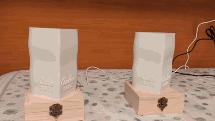
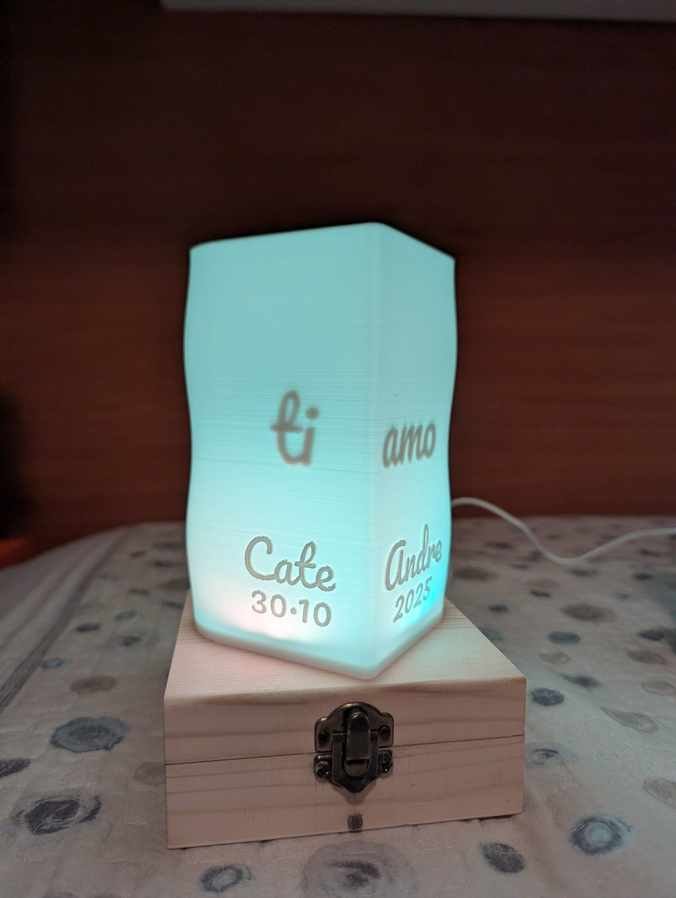
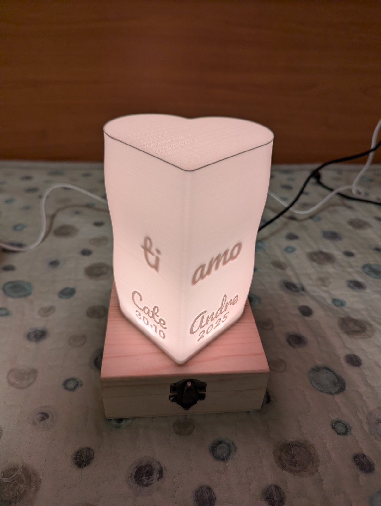
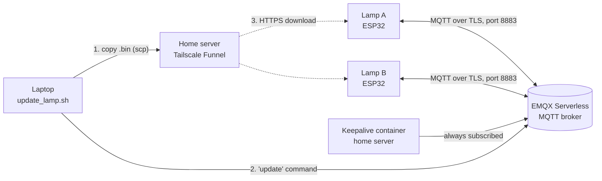

# Twin Lamps

Two touch lamps that keep two people in touch: touch yours, and the other one lights up in your color, wherever it is.

<p align="center">
  
  <br>
  <sub>One lamp is touched, the other lights up. <a href="docs/images/twin-lamps-demo.mp4">Sharper MP4 version</a>.</sub>
</p>

I built these two lamps as a gift for our first anniversary. Cate and I live far apart, so the idea was simple: when one of us touches their lamp, the other one lights up. Lamp A is mine and glows green; lamp B is Cate's and glows yellow, like a sunflower at sunset. Along the way they learned a few more gestures (a goodnight sunset, a heartbeat while you keep your finger on the hook), some special dates, and a small ritual: on the 30th of every month, the day we got together, both lamps stay red from midnight to midnight. Inside the shade there is a hidden "ti amo" ("I love you" in Italian) that only shows when the lamp is lit.

Each lamp is an ESP32 in a small pine box, a 16-LED ring under a 3D-printed heart-shaped shade, and the metal latch of the box used as the touch sensor. The lamps never talk to each other directly: they meet on a free cloud MQTT broker, so they work on any two Wi-Fi networks, hundreds of kilometers apart.

<p align="center">
  
  
</p>

> Cameras render the LED colors a bit differently from how they look in person: in photos the yellow looks pinkish and the green looks teal.

## Features

| Gesture or event | What happens |
| --- | --- |
| Short tap | The other lamp "breathes" softly in your color for 10 minutes; yours gives a short flash to confirm. |
| Double tap | "Goodnight": the other lamp does a 60-second sunset (amber, orange, ember) and turns off. |
| Touch and hold (over 0.9 s) | The other lamp beats like a heart (lub-dub, 50 bpm) for as long as your finger stays on. |
| Both touch within 15 s | "Together": the two colors rotate on both lamps for 30 seconds. |
| Message not seen | If the breathing ends and nobody touched the lamp, one LED in the other person's color stays on until you touch yours. |
| 30th of every month | Solid red all day (last day of the month in February), with a two-comet animation at 21:00. |
| Special dates | Anniversary, both birthdays, Valentine's Day, Christmas and New Year: firework-style animations on both lamps at the same time. |
| Dark room | A photoresistor dims the lamp to 25% at night. |

Also: Wi-Fi setup from a phone (captive portal), a red dot when the broker is unreachable, over-the-air updates with automatic rollback, and remote tuning of colors, touch and light sensor over MQTT.

## How it works



Each lamp publishes its gestures (`tap`, `heart_on`, `heart_off`, `goodnight`) on its own topic and listens to the other lamp's topic. A small container on a home server stays connected to the broker so the free deployment is never stopped for inactivity. Firmware updates are served from the home server through Tailscale Funnel. More in [docs/ARCHITECTURE.md](docs/ARCHITECTURE.md).

## Bill of materials (per lamp)

| Part | Notes |
| --- | --- |
| ESP32 WROOM-32 devkit, USB-C | The classic ESP32: it has capacitive touch |
| WS2812B ring, 16 LEDs | 68 mm outer, 54 mm inner diameter |
| 330 Ω resistor, 100 µF 50 V capacitor | Data line and ring power |
| Photoresistor + 10 kΩ resistor | Automatic dimming |
| M2 bolts and nuts | Connect the touch wire to the metal latch |
| 5 V 1 A USB charger + USB-A to USB-C cable | A PC port is not enough at full brightness |
| Pine box 12×12×5 cm with hinged lid and metal latch | The base of the lamp |
| Bambu PLA Matte, white | Shade, cap and base |

Full list with tools and consumables: [hardware/BOM.md](hardware/BOM.md).

## Build it

1. **Print** the shade, cap and base: [3d-models/PRINTING.md](3d-models/PRINTING.md). To put your own names and date on the shade, use the parametric OpenSCAD model: [3d-models/README.md](3d-models/README.md).
2. **Wire** the ESP32, ring, photoresistor and touch hook: [hardware/WIRING.md](hardware/WIRING.md).
3. **Assemble** box, base, ring, shade and cap: [hardware/ASSEMBLY.md](hardware/ASSEMBLY.md).
4. **Set up the broker**: create a free EMQX Serverless deployment and one MQTT user, then run the keepalive container: [server/keepalive/](server/keepalive/docker-compose.yml) and [docs/ARCHITECTURE.md](docs/ARCHITECTURE.md#broker-and-keepalive).
5. **Flash the firmware** over USB:
   - copy `firmware/twin_lamps/secrets.example.h` to `secrets.h` and fill in your values;
   - set `#define LAMP_ID 'A'` for one lamp and `'B'` for the other;
   - Arduino IDE with the Espressif ESP32 core, board **ESP32 Dev Module**, Partition Scheme **Minimal SPIFFS (1.9MB APP with OTA/128KB SPIFFS)**, Upload Speed 115200; libraries WiFiManager (tzapu), PubSubClient, Adafruit NeoPixel.
6. **Connect to Wi-Fi**: on first boot the ring turns light blue and the lamp opens its own network ("Lampada di Andre" or "❤Lampada di Cate❤"). Join it from a phone, pick a 2.4 GHz Wi-Fi and save.
7. **Optional, remote updates**: host the firmware with Tailscale Funnel ([server/OTA_HOSTING.md](server/OTA_HOSTING.md)) and update with `tools/update_lamp.sh` ([docs/OTA_UPDATES.md](docs/OTA_UPDATES.md)).

Tested with Arduino IDE 2.3.10, esp32 core 3.3.12, WiFiManager 2.0.17, PubSubClient 2.8 and Adafruit NeoPixel 1.15.5. The firmware is v2.6, the version running on both lamps.

## Documentation

| Document | Contents |
| --- | --- |
| [docs/ARCHITECTURE.md](docs/ARCHITECTURE.md) | Components, message flow, broker and keepalive, security notes |
| [docs/MQTT_COMMANDS.md](docs/MQTT_COMMANDS.md) | Topics, gestures and remote commands (the protocol is in Italian) |
| [docs/OTA_UPDATES.md](docs/OTA_UPDATES.md) | How a remote update works and how to run one |
| [docs/TROUBLESHOOTING.md](docs/TROUBLESHOOTING.md) | Symptoms, causes and fixes |
| [hardware/](hardware/) | Bill of materials, wiring, assembly |
| [3d-models/](3d-models/) | STL files, parametric source, print settings |
| [server/](server/) | Keepalive container and firmware hosting |
| [CHANGELOG.md](CHANGELOG.md) | From the first prototype to v2.6 |

## Repository layout

```
twin-lamps/
├── firmware/twin_lamps/     ESP32 sketch + secrets.example.h
├── hardware/                BOM, wiring diagram, assembly
├── 3d-models/               STL files, OpenSCAD source, print settings
├── server/
│   ├── keepalive/           docker-compose.yml + .env.example
│   └── OTA_HOSTING.md
├── tools/                   update_lamp.sh + .env.example
└── docs/                    architecture, MQTT commands, OTA, troubleshooting, images
```

## Credits

- Font: [Pacifico](https://fonts.google.com/specimen/Pacifico) by Vernon Adams, SIL Open Font License 1.1 (the lettering on the shade).
- Libraries: [WiFiManager](https://github.com/tzapu/WiFiManager) by tzapu, [PubSubClient](https://github.com/knolleary/pubsubclient) by Nick O'Leary, [Adafruit NeoPixel](https://github.com/adafruit/Adafruit_NeoPixel), [Arduino core for ESP32](https://github.com/espressif/arduino-esp32) by Espressif.
- Services and tools: [EMQX Serverless](https://www.emqx.com/en/cloud/serverless-mqtt), [Tailscale Funnel](https://tailscale.com/kb/1223/funnel), [Eclipse Mosquitto](https://mosquitto.org/) clients, [OpenSCAD](https://openscad.org/).

## License

- Code (`firmware/`, `tools/`, `server/`): [MIT](LICENSE).
- 3D models, documentation, diagrams, photos and videos: [CC BY-NC-SA 4.0](LICENSE-CC-BY-NC-SA.md). Build them for yourself and for the people you love, remix them, just don't sell them.
