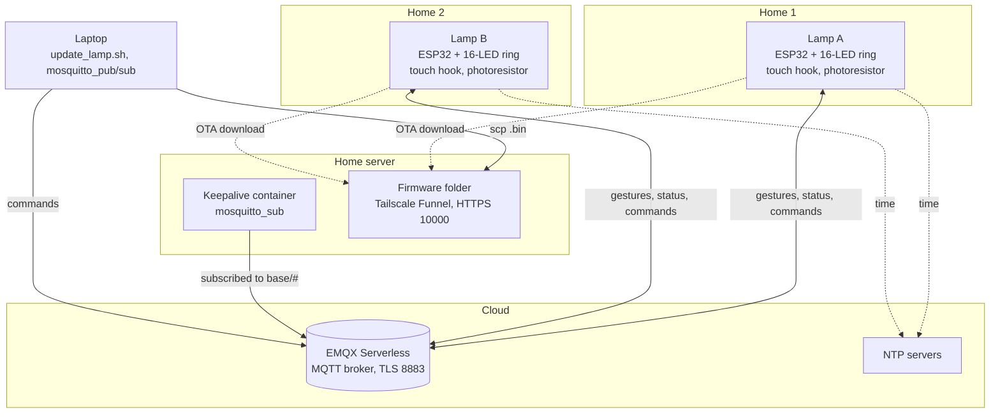
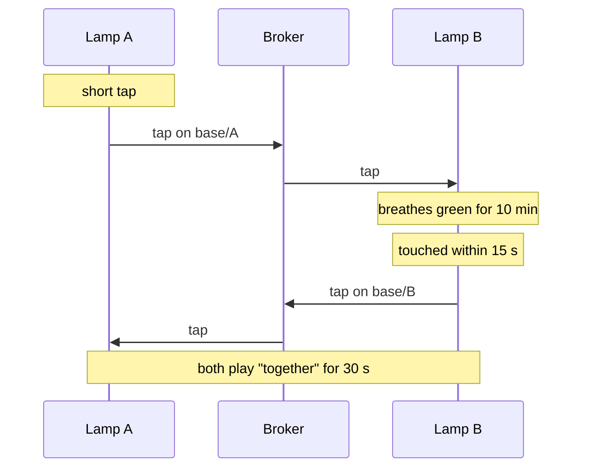

# Architecture

## Components



- **Lamps.** Each lamp is an ESP32 with a WS2812B ring, a capacitive touch input on the metal latch and a photoresistor. It joins Wi-Fi through WiFiManager (a setup network and web page on first boot) and talks only to the MQTT broker, so the two lamps can be on any two networks without opening ports.
- **Broker.** EMQX Serverless, free tier, over TLS on port 8883. One MQTT user is shared by both lamps, the keepalive and the laptop.
- **Keepalive.** EMQX stops a Serverless deployment after 30 days without connected clients, and deletes it after another 30. A tiny container on a home server stays subscribed all the time, so the broker survives even when both lamps are off.
- **Firmware hosting.** For remote updates the lamp downloads its `.bin` over HTTPS from a folder on the home server, published with Tailscale Funnel. See [OTA_UPDATES.md](OTA_UPDATES.md).
- **Time.** The lamps get the time from NTP (`pool.ntp.org`, `time.google.com`) with the Italian time zone and automatic daylight saving time, for the special dates and the 30th of the month.

## Messages

Each lamp publishes on its own topic and subscribes to the other's, plus its own command topic. The topic base works as a private channel: pick something hard to guess. Full list in [MQTT_COMMANDS.md](MQTT_COMMANDS.md).



| Situation | What the lamp shows |
| --- | --- |
| No saved Wi-Fi, or the saved one is not reachable | Light blue ring and the setup network for 5 minutes, then it restarts and tries again |
| Wi-Fi works but the broker does not | A dim red dot on LED 0; it retries every 5 seconds |
| Connected | Off, unless a gesture, a special date or the red of the 30th is playing |

When the lamp connects it publishes `online v<version> rssi=<signal>` as a retained status. If the lamp drops off, the broker publishes its last will, `offline`, on the same topic.

## Firmware

The sketch is a single file, [firmware/twin_lamps/twin_lamps.ino](../firmware/twin_lamps/twin_lamps.ino). Private values (broker, user, passwords, topic base, firmware address) live in `secrets.h`, which is not committed; [secrets.example.h](../firmware/twin_lamps/secrets.example.h) is the template. The only difference between the two lamps is `#define LAMP_ID 'A'` or `'B'`, which picks the colors, the topics, the setup network name and the tag `LAMPADA-ID:A` or `LAMPADA-ID:B` that the update script checks.

The main loop repeats with a 10 ms pause: MQTT, pending update, clock, special dates, touch, then rendering. All animations are drawn into a floating-point buffer and scaled by the ambient light factor before going to the LEDs. The photoresistor is read only when no animation has played for 1.5 s, so it does not measure the light of the lamp's own animations.

Touch handling:

- The sensor is calibrated at boot (do not touch the lamp while it starts) and slowly recalibrated while untouched.
- A touch counts when the reading stays below `baseline × touch_ratio` for at least 50 ms, which filters out noise.
- The release has hysteresis and a 60 ms debounce.
- Over 0.9 s it becomes a heartbeat; a second tap within 0.4 s turns the first one into "goodnight".

## Broker and keepalive

1. Create a free account on [EMQX Cloud](https://www.emqx.com/en/cloud/serverless-mqtt) and a **Serverless** deployment in the region closest to you. Set the spending limit to 0 to stay on the free tier.
2. Under Access Control → Authentication, add one MQTT user and password.
3. The host is on the deployment's Overview page (something like `your-deployment.emqxsl.com`); the TLS port is 8883.
4. Run the keepalive on any always-on machine with Docker:

   ```bash
   cd server/keepalive && cp .env.example .env
   ```

   Fill in `.env`, then:

   ```bash
   docker compose up -d
   ```

   Check that it receives the lamps' messages with `docker logs lamps-keepalive`. The logs are capped at 3 × 1 MB.

## Security notes

This is a gift between two people, not a product. The trade-offs, so you can choose differently:

- **TLS without certificate checks.** The lamps encrypt the connection to the broker and to the firmware server, but do not verify the certificates (`setInsecure()`). It keeps the firmware simple and immune to certificate rotations, at the cost of not detecting a man-in-the-middle.
- **Credentials inside the firmware.** The broker password and the firmware address are compiled into the `.bin`. Never publish a compiled binary, and delete it from the server after each update.
- **Topic base as a private channel.** Anyone with the broker credentials can read and send gestures; the hard-to-guess topic base is an extra layer, not access control. Use your own broker user.
- **Firmware address fixed at compile time.** The `update` command carries no URL, so nobody with access to the broker can make a lamp download a different firmware.
- **Setup network password.** The temporary Wi-Fi network for the first setup is protected by `SECRET_AP_PASS`.
