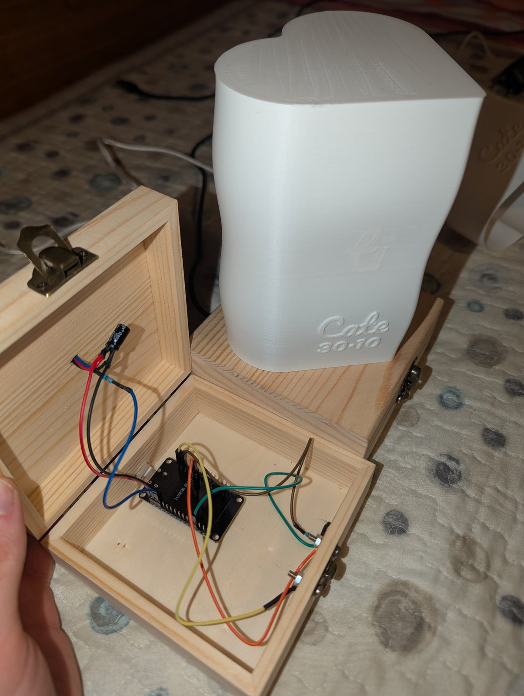
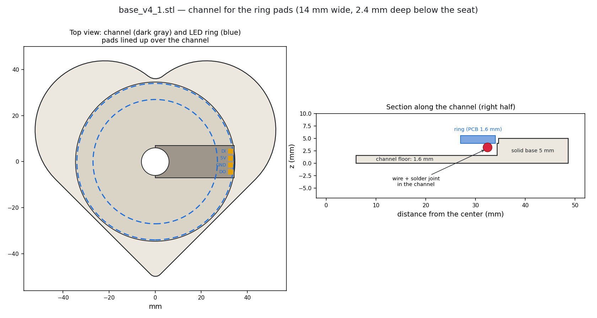

# Assembly

## The box

The base is a pine box, 12 × 12 × 5 cm, with a hinged lid and a metal latch. In the one used here the walls are about 1 cm thick, the bottom part is 2.3 cm tall and the lid 1.3 cm. With the box closed there is only about 1.6 cm of room inside: **measure yours** before planning the layout.

Holes to drill:

| Hole | Size | Where |
| --- | --- | --- |
| Ring wires | 12 mm | Center of the lid, under the hole of the printed base |
| USB cable | about 12 mm | Back of the box, lined up with the ESP32's USB-C port |
| Photoresistor | 5 mm | One side of the box, facing the room: it must not see the light of the lamp |
| Latch bolts | for M2 | Through the latch half fixed on the bottom part of the box |

## Inside the box

- Solder the wires straight to the ESP32 pins, trimmed to about 3 mm (no Dupont connectors: they do not fit).
- Lay the capacitor flat.
- Support the ESP32 properly: put it on thick double-sided tape, module side down, and fix the cable with a strain relief (a cable tie or a dab of glue on the wood, not on the board). The board should never hang on its USB-C connector.
- Keep the USB-C port reachable through the back hole, so you can still flash the board by cable if a remote update is not possible.
- Leave the ring wires long: they bend every time the lid is opened.

## The LED ring

- Before mounting, file off the small tabs left on the edge of the ring where it was broken off the panel: the seat in the base has only 0.6 mm of clearance on the diameter.
- Solder the wires **flat** on the pads, pointing towards the center, and route them down through the 12 mm hole.
- Rotate the ring so that the pads sit over the channel in the base: the channel (14 mm wide, 2.4 mm deep) makes room for the solder joints, so the ring lies flat in its seat. Base v4 did not have it and the ring stayed lifted on one side.

## Mounting order

From the bottom up:

1. **Box lid.**
2. **Base**, glued to the lid with wood glue (PVA) or thick double-sided mounting tape. **No hot glue on PLA**: it can soften and deform the part.
3. **LED ring**, in the seat of the base, pads over the channel.
4. **Shade** (tube), pushed onto the base.
5. **Cap**, pushed into the top of the shade.

Ring, shade and cap are not glued, so the lamp can be taken apart. The fits are snug by design: if a part is too tight, sand it lightly. When traveling, take the shade off and pack it separately: it is the most fragile part.

## Before you close it

- Power the lamp from the 1 A charger, not from a PC port.
- Check on the Serial Monitor (115200 baud) that it boots, joins Wi-Fi and prints `MQTT connected`.
- Do not touch the latch while the lamp starts: it calibrates the touch sensor at boot.
- Try every gesture with the other lamp: tap, double tap, hold, and both touching within 15 s.
- Before giving a lamp away, flash it once with **Tools → Erase All Flash Before Sketch Upload: Enabled**, so it forgets your Wi-Fi and opens its setup network at the new home. Set the option back to Disabled afterwards.
