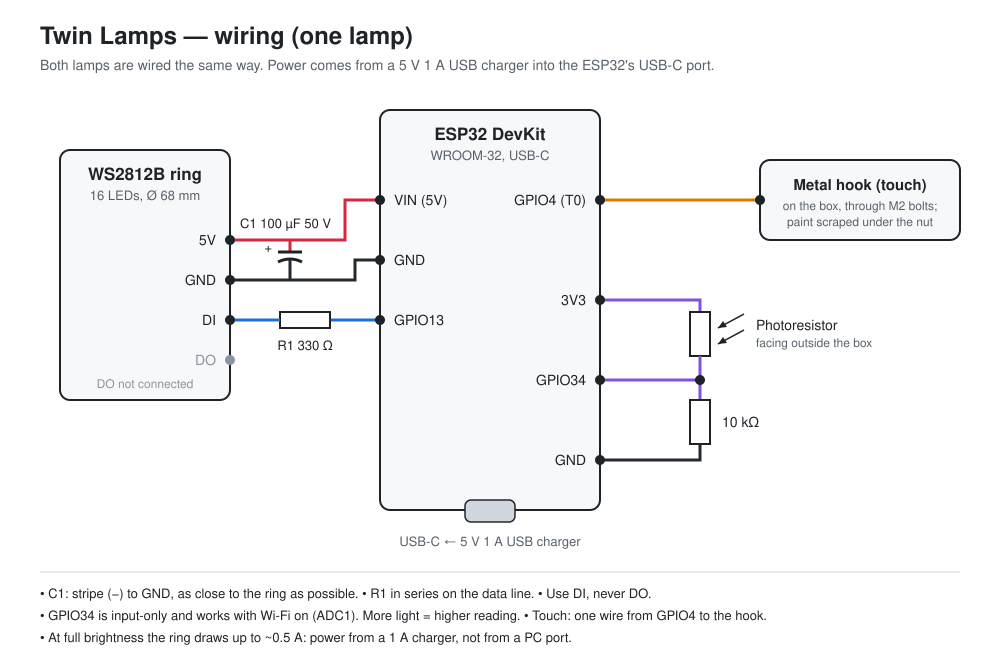

# Wiring

Both lamps are wired the same way. Power comes from a 5 V 1 A USB charger into the ESP32's USB-C port; the ring takes 5 V from the board's VIN pin.

## Connections

| # | From | To | In between |
| --- | --- | --- | --- |
| 1 | ESP32 VIN (5V) | Ring 5V | — |
| 2 | ESP32 GND | Ring GND | — |
| 3 | Ring 5V | Ring GND | 100 µF 50 V capacitor, stripe (−) to GND, lying flat |
| 4 | ESP32 GPIO13 | Ring **DI** (not DO) | 330 Ω resistor in series |
| 5 | ESP32 GPIO4 (T0) | Metal latch (touch) | M2 bolts, paint scraped off under the nut |
| 6 | ESP32 3V3 | Photoresistor, leg 1 | — |
| 7 | ESP32 GPIO34 | Photoresistor leg 2 + 10 kΩ resistor | Soldered three-way joint, under heat-shrink |
| 8 | ESP32 GND (another pin) | 10 kΩ resistor, other end | — |

## Notes

- **Capacitor**: as close to the ring as possible, with the stripe (−) on GND.
- **Data line**: the 330 Ω resistor goes in series between GPIO13 and DI. Use DI, never DO (DO is the output towards a next ring and stays unconnected).
- **Photoresistor**: GPIO34 is input-only and belongs to ADC1, so it can read analog values while Wi-Fi is on (ADC2 pins cannot). More light gives a higher reading. Point the photoresistor outside the box, so it never sees the light of the lamp itself.
- **Touch**: a single wire from GPIO4 to the half of the latch fixed on the bottom part of the box. Bolt it through the wood with M2 bolts and scrape the paint off the latch under the nut, so the contact is metal to metal.
- **Saving height**: there is very little room inside the closed box. Do not use Dupont connectors on the ESP32: trim the pins you use to about 3 mm and solder the wires directly to them.
- **Power**: at full brightness the ring alone draws up to about 0.5 A. Powered from a PC port, the board can reset (brownout) when the LEDs are bright: use the 1 A charger.

Measured photoresistor readings with the 10 kΩ resistor: full dark 0, shutters half closed 15, room light in the evening 1242, cloudy daylight 1700–2740. The firmware treats anything under 15 as dark and anything over 600 as full light (`LDR_DARK`, `LDR_BRIGHT`, adjustable over MQTT).
